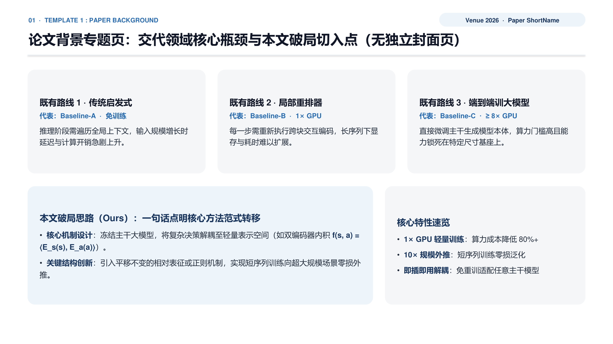
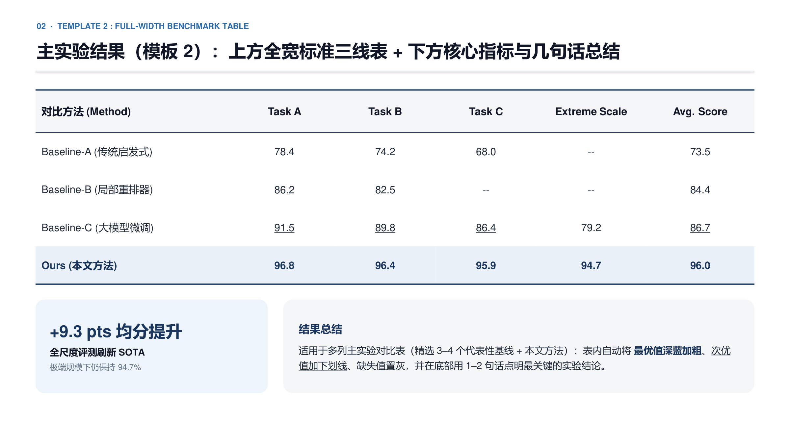
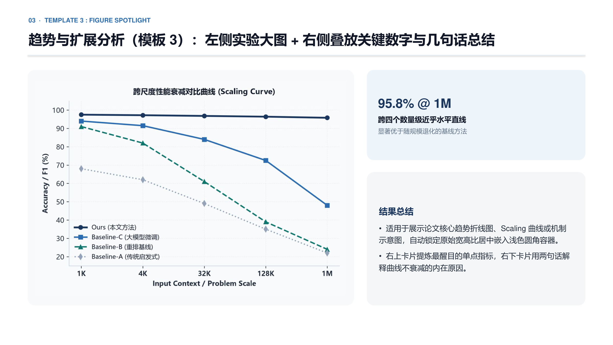
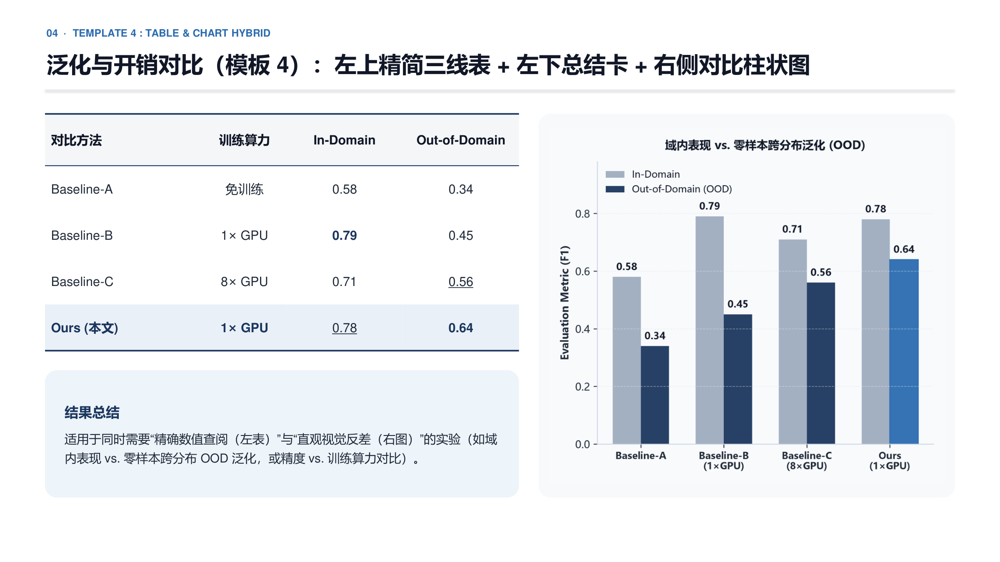
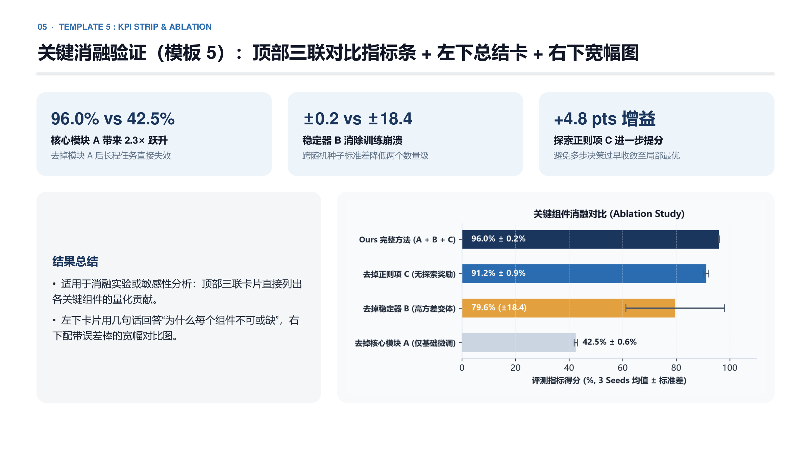
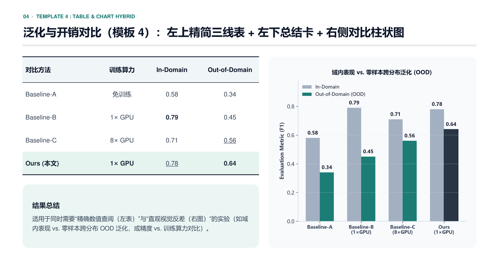
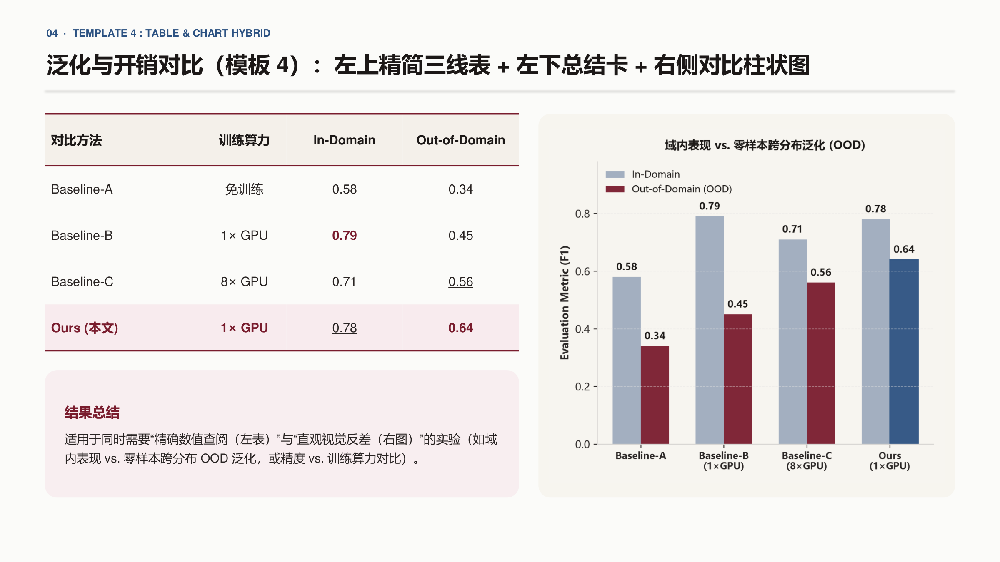

# `academic-ppt` — 跨平台极简学术论文汇报 Agent Skill

**`academic-ppt`** 是一套专为 **学术论文精读、实验室组会交流 Idea、核心实验数据汇报** 设计的 AI Agent Skill（支持 Antigravity、Claude Code、Cursor、Codex 等）。

它采用 **“5 页极简短模板体系（5-Slide Short Deck Spec）”**，从底层 OOXML 标签解决 **macOS（PowerPoint / Apple Keynote）与 Windows PowerPoint** 之间的中英文字体回退、三线表跑版与高分屏图表模糊问题。

---

## 核心设计理念

1. **去繁就简的 5 页短模板结构（无冗余封面页 / 无致谢结尾页）**
   - 不生成占版面的大标题开始页或“Thank You / Q&A”结尾页。
   - **第 1 页（论文背景专题页）**：与后文保持完全一致的极简顶栏与圆角卡片视觉语言，聚焦交代**既有路线痛点与本文破局思路**（右上角辅以轻量胶囊标签注明顶会/论文来源）。
   - **第 2–5 页（4 套互补的“数据展示 + 几句话总结”版式）**：严格遵循**一页一个明确实验 + 一组对比结果 + 2–3 句话结论总结**，让听众在 3 秒内看懂实验做了什么、效果如何。
2. **极简净空版面与柔和浅色圆角卡片**
   - **底部彻底留白**：无底部论文标题缩写、无页码计数、无底部分割线（`verify_deck.py` 自动拦截任何侵入底部 `0.50 in` 净空区的元素）。
   - **浅色无边框圆角矩形**：摒弃生硬的深色竖条粘连元素、硬边框与默认阴影，统一采用按宽高比自适应修正的等圆角半径柔和卡片（`#EEF4FB` 冰蓝高亮卡 / `#F4F6F9` 浅灰总结卡 / `#F8FAFC` 图表容器）。
3. **原生跨平台（macOS 为主 + Windows 100% 兼容）**
   - **双脚本字体严格配对（`<a:latin>` + `<a:ea>`）**：西文与实验数字锁定 `Arial`（Mac 与 Win 字形宽度 100% 一致，多列小数点天然对齐）；中文锁定 `Microsoft YaHei`（Windows 与 Mac 版 Office 原生内置；在未装 Office 的 Mac 上用 **Apple Keynote** 打开时由 CoreText 平滑映射至 **苹方 `PingFang SC`**，绝不回退成宋体 `SimSun`）。
   - **标准 LaTeX `booktabs` 学术三线表**：零竖线、自动识别 `**最优加粗**` 与 `__次优下划线__`、`Ours` 行浅底色高亮。

---

## 5 套内置标准版式模板预览

> 仓库内置通用模板演示文件：[examples/5slide_template_demo.pptx](./examples/5slide_template_demo.pptx)（由 [examples/build_5slide_template_demo.py](./examples/build_5slide_template_demo.py) 生成）。

| 页序 | `AcademicDeck` 模板方法 | 适用场景与版式布局 |
| :--- | :--- | :--- |
| **Slide 1** | `add_background_slide(...)` | **论文背景专题页**：上排三联既有路线瓶颈卡片 + 下排左宽“本文破局核心思路”卡与右“核心特性速览”卡 |
| **Slide 2** | `add_table_summary_slide(...)` | **全宽主表型**：上方全宽多列 `booktabs` 三线表 + 下方“单点核心指标卡 + 几句话总结卡” |
| **Slide 3** | `add_figure_summary_slide(...)` | **左图右评型**：左侧高分辨率实验趋势图/架构图（锁定原始宽高比）+ 右侧上下叠放指标与总结卡 |
| **Slide 4** | `add_hybrid_table_chart_slide(...)` | **表图联动型**：左上精简四列三线表 + 左下几句话总结卡 + 右侧 300-DPI 分组对比柱状图 |
| **Slide 5** | `add_kpi_chart_summary_slide(...)` | **顶栏指标 + 宽图型**：顶部三联关键对比数字条 + 左下几句话总结卡 + 右下宽幅误差棒消融图 |

### 模板 1：论文背景专题页 (`add_background_slide`)


### 模板 2：全宽三线表 + 底部总结 (`add_table_summary_slide`)


### 模板 3：左侧实验大图 + 右侧叠放总结 (`add_figure_summary_slide`)


### 模板 4：左精简表与总结 + 右对比柱状图 (`add_hybrid_table_chart_slide`)


### 模板 5：顶部三联指标条 + 左评右宽图 (`add_kpi_chart_summary_slide`)


---

## 3 套内置学术配色主题

切换 `--theme` 参数即可自动同步母版背景、三线表规则线、圆角卡片色阶（`bg_tint` / `bg_subtle` / `bg_card`）及 Matplotlib 300-DPI 图表色板：

| 主题 ID | 配色风格 | 预览 |
| :--- | :--- | :--- |
| **`classic-conference`** *(默认)* | 纯白画布 `#FFFFFF` + 深海蓝 `#1B365D` + 冰蓝圆角卡 `#EEF4FB` |  |
| **`slate-analytics`** | 纯白画布 `#FFFFFF` + 墨石深灰 `#1E293B` + 薄荷青圆角卡 `#EBF6F4` |  |
| **`warm-monograph`** | 护眼暖白 `#FCFCFA` + 牛津酒红 `#7A1C2E` + 柔粉圆角卡 `#F9EFF1` |  |

---

## 快速安装与使用

### 1. 环境准备（macOS & Windows 通用）
本 Skill 所有脚本均内嵌 PEP 723 依赖声明，只需安装 [`uv`](https://docs.astral.sh/uv/)，首次运行时会自动拉取隔离环境（`python-pptx`、`matplotlib`、`pillow`、`numpy`、`lxml`、`pymupdf`），无需手动配置虚拟环境：

```bash
# macOS (Homebrew)
brew install uv

# Windows (PowerShell)
powershell -ExecutionPolicy ByPass -c "irm https://astral.sh/uv/install.ps1 | iex"
```

### 2. 安装 Skill 到本地 Agent

**方式 A：克隆到当前项目工作区（推荐随项目同步）**
```bash
git clone https://github.com/AliasHe103/academic-ppt-skill.git .agents/skills/academic-ppt
```

**方式 B：克隆到全局用户级 Skills 目录**
```bash
# macOS / Linux (Antigravity)
git clone https://github.com/AliasHe103/academic-ppt-skill.git ~/.gemini/antigravity/skills/academic-ppt

# Windows PowerShell (Antigravity)
git clone https://github.com/AliasHe103/academic-ppt-skill.git "$HOME\.gemini\antigravity\skills\academic-ppt"
```

### 3. 在对话中触发使用
直接向 Agent 提问即可自动激活 `academic-ppt`：
> - *“帮我用 `academic-ppt` 把本地 `paper.pdf` 做成一份 5 页组会交流 PPT，重点展示主实验表、长度外推曲线和消融实验。”*
> - *“读取 `results/` 下的实验 CSV，用 `slate-analytics` 主题生成一份 5 页极简数据汇报 PPT。”*

### 4. 命令行独立生成与质检验证
```bash
# 生成 5 页通用展示模板 (.pptx)
uv run .agents/skills/academic-ppt/examples/build_5slide_template_demo.py --theme classic-conference

# 运行自动质检（双字体标签检查、越界/重叠检测、底部净空校验、5页上限检查 + 导出高清预览图）
uv run .agents/skills/academic-ppt/scripts/verify_deck.py .agents/skills/academic-ppt/examples/5slide_template_demo.pptx --render-dir ./preview_pngs
```

---

## 仓库目录结构

```text
academic-ppt-skill/
├── SKILL.md                                   # Agent 技能主规范与工作流指令
├── README.md                                  # 仓库说明文档与模板预览
├── examples/
│   ├── build_5slide_template_demo.py          # 5 页通用展示模板生成脚本（标准 API 调用示例）
│   ├── 5slide_template_demo.pptx              # 5 页通用展示模板成品
│   └── previews/                              # 模板与主题实机渲染预览图
├── references/
│   ├── paper-deck-patterns.md                 # 5 套标准版式线框图、密度守则与三线表规范
│   └── cross-platform-guide.md                # macOS / Windows 双字体 OOXML 顺序与 300-DPI 规范
├── resources/
│   ├── themes/                                # 3 套主题色板与字体链 JSON 定义
│   └── templates/                             # 预置双字体与色板的 16:9 空白母版 (.pptx)
└── scripts/
    ├── academic_ppt_core.py                   # 核心排版引擎（含 5 大标准模板方法与底层原语）
    ├── build_templates.py                     # 从主题 JSON 重建空白母版
    └── verify_deck.py                         # 跨平台 PPTX 自动质检与高清 PNG 渲染器
```
